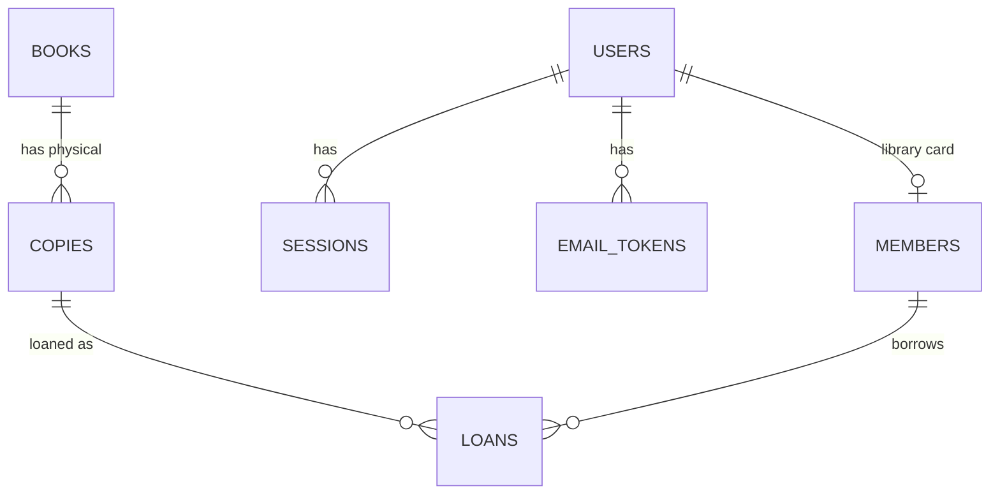

# Library Management System — Plan

**Stack:** Next.js 16 (frontend) · NestJS 12 (API) · PostgreSQL 16 · TypeORM
**Status:** v4 — rebuilt on Next.js + NestJS, same features and database (2026-11-09)
**Repo:** `github.com/utshojoy1/libery-managment`

---

## Contents

1. [What shipped](#1-what-shipped)
2. [Roles & access](#2-roles--access)
3. [Running it](#3-running-it)
4. [Architecture](#4-architecture)
5. [Data model](#5-data-model)
6. [Auth design](#6-auth-design)
7. [Account flows](#7-account-flows)
8. [Business rules](#8-business-rules)
9. [API](#9-api)
10. [Project layout](#10-project-layout)
11. [Verification](#11-verification)
12. [Deferred](#12-deferred)
13. [Roadmap](#13-roadmap)
14. [Decisions log](#14-decisions-log)

---

## 1. What shipped

A staff + member web app with real accounts, email verification, and self-service password reset.

| Screen | Route | Access |
|---|---|---|
| Login | `/login` | public |
| Register | `/register` | public |
| Forgot password | `/forgot-password` | public |
| Reset password | `/reset-password?token=…` | public |
| Verify email | `/verify-email?token=…` | public |
| Dashboard | `/` | signed in — staff see stats, members see their loans |
| Catalog | `/catalog` | signed in — staff can add titles |
| Members | `/members` | staff |
| Circulation | `/circulation` | staff |
| Users & access | `/admin/users` | super admin |
| Dev inbox | `/dev/mail` | development only |

Stack as built: Next.js 16.4 (React 19.3, App Router) on :3000, NestJS 12.4 (Express) on :4000, PostgreSQL 16 in Docker, TypeORM 1.1 (@nestjs/typeorm), class-validator DTOs, `pg` 8.23.1, nodemailer 7 (optional), Node 24, npm workspaces. Hand-written CSS, no UI framework.

---

## 2. Roles & access

Three roles, ordered: `member` < `admin` < `super_admin`.

| Capability | Member | Admin | Super admin |
|---|:--:|:--:|:--:|
| Browse catalog | ✓ | ✓ | ✓ |
| See own loans | ✓ | — | — |
| Add books / copies | — | ✓ | ✓ |
| Manage members | — | ✓ | ✓ |
| Issue / return | — | ✓ | ✓ |
| Manage accounts (role, disable) | — | — | ✓ |

Enforcement is layered:

1. **API** — a global NestJS guard denies every route without a session unless it is `@Public()`; `@Roles()` narrows it. This is the real boundary.
2. **Frontend** — `proxy.ts` sends requests without a session cookie to `/login?redirect=…`; every page then checks the session (and its role) on the server through `lib/dal.ts`, redirecting before anything renders.
3. **UI** — nav items and actions are hidden by role.

Open registration always creates a `member`; only a super admin promotes to `admin` or `super_admin`.

---

## 3. Running it

```bash
docker compose up -d db      # or npm run db:start
npm install
npm run db:migrate
npm run db:seed              # prints demo accounts
npm run dev                  # API :4000 + web http://localhost:3000
```

**Demo accounts** (seeded, already verified):

| Role | Email | Password |
|---|---|---|
| Super admin | `superadmin@library.local` | `Super12345` |
| Admin | `admin@library.local` | `Admin12345` |
| Member | `member@library.local` | `Member12345` |

Database: container `library-db`, host port **5434** (5433 belongs to another local Postgres).

Mail: without `SMTP_URL` every message lands in the outbox and is visible at `/dev/mail`. With `SMTP_URL` + `MAIL_FROM` set, nodemailer delivers and the outbox records the status.

---

## 4. Architecture

```
Browser
    │  httpOnly session cookie (first-party)
Next.js :3000  ── Server Components + Server Actions call the API server-side
    │
NestJS :4000  ── global AuthGuard (session → req.user, @Public / @Roles)
    ├── TypeORM → PostgreSQL (users, sessions, email_tokens, emails,
    │                        books, copies, members, loans)
    └── MailService → SMTP (if configured) + outbox row
```

One deployable Node app, one database. No queue or background workers yet — mail is sent inline, which is correct at this volume.

**Concurrency:** checkout/return run in a transaction and take `SELECT … FOR UPDATE` on the copy row.

---

## 5. Data model



| Table | Columns |
|---|---|
| `users` | id, email (unique), name, password_hash, role, is_active, email_verified_at, created_at |
| `sessions` | id (sha256 of token), user_id → users, expires_at, created_at |
| `email_tokens` | id, user_id → users, purpose (`verify_email` \| `reset_password`), token_hash (unique), expires_at, used_at, created_at |
| `emails` | id, to, subject, text, status (`queued` \| `sent` \| `failed`), error, created_at, sent_at |
| `members` | id, user_id → users (unique, nullable), member_no (unique), name, email, phone, joined_at, is_active |
| `books` | id, title, author, isbn, category, published_year, created_at |
| `copies` | id, book_id → books, barcode (unique), status `available \| on_loan` |
| `loans` | id, copy_id → copies, member_id → members, issued_at, due_at, returned_at, status `active \| returned` |

Key constraints:

```sql
CREATE UNIQUE INDEX loans_one_active_per_copy ON loans (copy_id) WHERE status = 'active';
CREATE INDEX loans_active_member ON loans (member_id) WHERE status = 'active';
```

Notes: authors are a text column (no join table yet); loan rules are constants, not settings; no branches, fines or reservations yet.

---

## 6. Auth design

| Concern | Decision |
|---|---|
| Password storage | `scrypt` with a 16-byte random salt, `scrypt:<salt>:<hash>`; compare with `timingSafeEqual` |
| Session token | 32 random bytes (base64url) in cookie `library_session`; DB stores only SHA-256 |
| Cookie flags | `httpOnly`, `SameSite=Lax`, `Secure` in production, 7-day expiry |
| Logout | Deletes the session row and clears the cookie |
| Disabled accounts | Rejected at login and on every request |
| Enumeration | Login says "Invalid email or password"; forgot-password always returns 200 |
| Escalation | Role changes are super-admin only; no self-demotion/self-disable; last super admin protected |

---

## 7. Account flows

### Email verification

1. Register (or press **Resend**) → 32-byte token, stored as SHA-256 with a 24-hour expiry.
2. Any earlier unused verification token is invalidated first, so old emails stop working.
3. Link `/verify-email?token=…` → the page posts the token, which is marked used and `users.email_verified_at` is set.
4. Unverified users can still sign in; a banner offers a resend. Resends are limited to 3 per 10 minutes.
5. The token is consumed on POST, not on page load — link scanners in mail clients can't burn it.

### Password reset

1. `/forgot-password` → always 200, whether or not the address exists.
2. For a real, active account: 1-hour token, previous reset tokens invalidated, email sent.
3. `/reset-password?token=…` → new password (min 8 chars) → token consumed.
4. Every session for that user is deleted, so a compromised session dies with the reset.
5. Rate limits: 3 requests per address / 15 min, 10 attempts per IP / 15 min.

### Tokens in general

- Random 32 bytes, base64url; only SHA-256 stored.
- Single use (`used_at`), purpose-scoped, expiring.
- Invalid/expired/reused links return `400` with a "request a new one" message.

### Mail transport

- `sendMail()` writes every message to `emails` first.
- With `SMTP_URL` set it delivers via nodemailer and records `sent` / `failed` + error.
- Without SMTP it stays `queued`, prints to the server log, and appears in `/dev/mail`.
- `/api/dev/outbox` returns 404 when `NODE_ENV=production`.

---

## 8. Business rules

| Rule | Where |
|---|---|
| 14-day loan period | `backend/src/loans/loans.service.ts` |
| Max 5 active loans per member | checkout, same transaction |
| Member must exist and be active | checkout |
| Copy must exist and be `available` | checkout, under row lock |
| Copy must be on loan to return | return |
| One active loan per copy | partial unique index |
| Overdue = `due_at < now()` | computed at query time |

---

## 9. API

| Method | Route | Access | Purpose |
|---|---|---|---|
| POST | `/api/auth/register` | public | Create member (+ card), send verification |
| POST | `/api/auth/login` | public | Start session |
| POST | `/api/auth/logout` | any | End session |
| GET | `/api/auth/me` | signed in | Current user |
| POST | `/api/auth/verify-email` | public | `{ token }` |
| POST | `/api/auth/resend-verification` | signed in | New confirmation link |
| POST | `/api/auth/forgot-password` | public | `{ email }` — always 200 |
| POST | `/api/auth/reset-password` | public | `{ token, password }` |
| GET | `/api/dev/outbox` | dev only | Recent messages |
| GET | `/api/stats` | staff | Counters |
| GET | `/api/books?q=` | signed in | Titles + availability |
| POST | `/api/books` | staff | Add title (+ copies) |
| GET | `/api/members` | staff | Members + loan counts |
| POST | `/api/members` | staff | Add member |
| GET | `/api/loans?status=&limit=` | staff | All loans |
| GET | `/api/loans/mine` | member | Own loans |
| POST | `/api/loans/checkout` | staff | `{ memberNo, barcode }` |
| POST | `/api/loans/return` | staff | `{ barcode }` |
| GET | `/api/admin/users` | super admin | All accounts |
| PATCH | `/api/admin/users/:id` | super admin | `{ role?, isActive? }` |

---

## 10. Project layout

```
backend/                        NestJS
  src/main.ts, app.module.ts     bootstrap, ValidationPipe, root module
  src/<feature>/                module + controller + service + entity + dto/ (auth, users, members, books, loans, stats, mail)
  src/common/                   roles, decorators, DTO transforms, rate limiter
  src/database/                 data source + TypeORM migrations
  scripts/seed.mjs
  test/api.test.mjs             node:test against the live API
frontend/                       Next.js App Router
  app/(app)/                    sidebar layout; dashboard,
                                catalog, members, circulation, admin/users
  app/(auth)/                   login, register, forgot/reset password, verify
  app/dev/mail/                 dev inbox
  app/<route>/_components, actions.ts   client forms, Server Actions
  lib/                          server-only API client, DAL (verifySession), types
  proxy.ts                      redirect when there is no session cookie
scripts/dev.mjs                 `npm run dev` runs both apps
```

---

## 11. Verification

Tested against the running app:

**Accounts & roles**
- Anonymous `/` → 302 to `/login?redirect=/`; `/api/stats` → 401.
- Each demo account logs in with the right role; wrong password → 401.
- Member: `/api/loans/mine` 200; `/api/members` 403; `POST /api/books` 403; `/members` → redirected home.
- Admin: `/api/admin/users` 403. Super admin: 200; promote works; self-demotion 400.
- Register: new account `member` + `M006`; duplicate email 409; short password 400.
- Logout → `/api/auth/me` 401.

**Email verification**
- Register → `emailVerified: false`; outbox holds a 24-hour link.
- POST token → 200; `/api/auth/me` then reports `emailVerified: true`.
- Reusing the token → 400. Resending when verified → 400. Bogus token → 400.

**Password reset**
- Forgot for a known address → 200 + outbox link; unknown address → 200 with no mail.
- Reset token → 200; old password 401; new password 200; the pre-reset session 401.
- Reusing the reset token → 400.

**UI**
- Browser-tested: login, forgot-password success state, dev inbox, reset form, unverified banner on the dashboard.

---

## 12. Deferred

| Area | Why deferred |
|---|---|
| Login rate limiting | Reset/resend are limited; login still needs a per-IP/account limiter |
| Session list & revoke UI | Sessions are already revoked on reset; need a management screen |
| 2FA / passkeys | Hardening after public exposure |
| Fines & payments | Needs policy: rate, grace, cap, currency |
| Reservations / hold queue | Needs a member-facing request flow |
| Renewals | Depends on holds + limits config |
| Background jobs (pg-boss) | Mail is inline today; fine at this volume |
| Reports & audit log | Audit now possible since actions are attributable |
| Multi-branch, S3 covers, tests/CI, Docker deploy | Later phases |

---

## 13. Roadmap

### Phase 1 — Accounts ✅
Login, register, logout, roles, super-admin access management.

### Phase 2 — Account flows ✅
Email verification, password reset, tokens, rate limits, dev inbox, SMTP support.

### Phase 3 — Hardening (≈1–2 days)
- Login rate limiting (per IP and per account).
- Session list + revoke in `/admin/users`.
- Unit tests for tokens/limits and Playwright happy paths.
- Production build + Dockerfile.

### Phase 4 — Money (≈3–4 days)
- `fines` + `payments`; rate, grace, cap from settings.
- Mark fines on return; cash payment at the desk.

### Phase 5 — Holds & self-service (≈4–5 days)
- Reservations with FIFO queue and hold-shelf expiry.
- Promote next hold on return.
- Email receipts and due reminders (pg-boss + Resend).

### Phase 6 — Scale out (≈1 week)
- Multi-branch, reports, audit log, backups/monitoring, deploy pipeline.

---

## 14. Decisions log

| Date | Decision | Rationale |
|---|---|---|
| 2026-11-06 | Simple web version first | Fastest path to something usable |
| 2026-11-06 | Real PostgreSQL | Same stack as target system |
| 2026-11-06 | Hand-written CSS, no UI framework | Few screens; avoids a dependency |
| 2026-11-06 | DB-backed sessions + scrypt, no auth library | Small, no native deps, full control |
| 2026-11-06 | Open registration → `member` role only | Staff access is granted, not self-served |
| 2026-11-06 | Super admin cannot demote/disable self; last super admin protected | Avoids locking everyone out |
| 2026-11-06 | Member accounts auto-create a library card | Self-registered users can borrow |
| 2026-11-06 | Hashed, single-use, purpose-scoped email tokens | Leaked DB rows can't be replayed; reuse fails |
| 2026-11-06 | Token consumed on POST, not page load | Mail-client link scanners can't burn links |
| 2026-11-06 | Password reset revokes all sessions | Kills a compromised session at reset |
| 2026-11-06 | Outbox-first mail with optional SMTP | Works offline for dev, one env var for production |
| 2026-11-06 | Dev inbox 404s in production | Prevents leaking reset links |
| 2026-11-09 | Rebuild as Next.js frontend + NestJS API | Requested stack; same schema and migrations, so existing data carries over |
| 2026-11-09 | Next.js proxies `/api/*` to NestJS | Session cookie stays first-party; no CORS |
| 2026-11-09 | API denies by default (global guard) | A forgotten guard can no longer expose a route |
| 2026-11-09 | Email links from `APP_URL` | Request Host header can be forged to steal reset tokens |
| 2026-11-09 | Backend reorganized into Nest feature modules on TypeORM | Follows the NestJS docs; entities match the Drizzle schema exactly, so existing databases carry over |
| 2026-11-09 | Frontend is server-first: Server Components, Server Actions, proxy.ts, DAL | Follows the Next.js docs; no blank screen while the session loads, and the API is called only from the server |

### Still open

1. **Fines** — charge at all? Rate, grace days, cap, currency.
2. **Public catalog** — should anonymous visitors browse before signing up?
3. **Staff onboarding** — self-register + promote, or invite-only accounts?
4. **Hosting** — on-prem at the library vs. cloud (affects TLS, email, backups).
