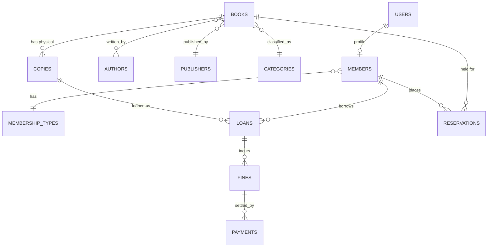

# Library Management System — Technical Plan

**Stack:** Nuxt 4 · PostgreSQL 16 · Drizzle ORM
**Status:** Draft for review
**Last updated:** 2026-11-06

---

## Contents

1. [Scope & assumptions](#1-scope--assumptions)
2. [Stack](#2-stack)
3. [Architecture](#3-architecture)
4. [Data model](#4-data-model)
5. [Core business rules](#5-core-business-rules)
6. [Routes & API](#6-routes--api)
7. [Project layout](#7-project-layout)
8. [Security](#8-security)
9. [Quality & operations](#9-quality--operations)
10. [Milestones](#10-milestones)
11. [Open decisions](#11-open-decisions)

---

## 1. Scope & assumptions

A web-based LMS for one or more branches, with a staff back-office and a member self-service portal.

| In scope | Out of scope (v1) |
|---|---|
| Catalog (books, copies, authors, categories) | MARC21 / Z39.50 import |
| Circulation: issue, return, renew, lost/damaged | Native mobile app |
| Memberships, limits, expiry | Online card payments (fines paid at desk) |
| Reservations/holds with queue | Inter-library loan |
| Fines & payments ledger | Digital lending (ebooks) |
| Reports, audit log, barcode support | Full acquisitions/ordering workflow |

**Assumptions:** English UI, single currency, barcodes via keyboard-wedge scanner, email notifications (no SMS in v1), deployment as a Node/Docker app with managed Postgres.

---

## 2. Stack

| Layer | Choice | Why |
|---|---|---|
| Framework | **Nuxt 4** (SSR, TypeScript, Nitro) | SEO-friendly public catalog + server routes in one codebase |
| UI | **Nuxt UI 4** (Tailwind) | Accessible components, dark mode, forms/tables out of the box |
| DB | **PostgreSQL 16+** | Constraints, partial indexes, FTS, `pg_trgm`, transactional integrity |
| ORM | **Drizzle ORM + drizzle-kit** | SQL-first, typed, first-class Postgres features, plain migrations |
| Validation | **Zod** schemas in `shared/` | Reused client + server |
| Auth | **nuxt-auth-utils** + own `users`/`sessions` tables, Argon2id | Full control over roles and audit |
| Jobs | **pg-boss** (Postgres-backed queue) | Overdue sweeps, reservation expiry, emails — no Redis |
| Files | S3-compatible (R2/MinIO), presigned uploads | Covers & member photos |
| Email | Resend / SMTP via Nodemailer | Receipts, due reminders |
| Tests | Vitest + Playwright | Business-rule units + E2E circulation |
| Deploy | Docker image + managed Postgres, migrations in CI | Reproducible |

---

## 3. Architecture

```
Browser (Nuxt SSR pages, staff & member portals)
    │  session cookie
Nitro server (server/api/*, server/middleware/auth.ts, server/tasks/*)
    ├── Drizzle → PostgreSQL (single primary)
    ├── pg-boss workers (in-process or separate worker container)
    └── S3 (covers), Resend (email)
```

One deployable app. Postgres stays the single source of truth — including the job queue, which keeps ops simple.

---

## 4. Data model



### Core tables

| Table | Key columns |
|---|---|
| `users` | id, email (unique), password_hash, name, role `admin\|librarian\|member`, branch_id, is_active |
| `members` | id, user_id, member_no (unique), membership_type_id, join_date, expires_at, status, photo_key |
| `membership_types` | id, name, max_loans, loan_days, max_renewals, grace_days, daily_fine_cents |
| `authors`, `publishers`, `categories` (self-referencing `parent_id`) | name, slug, bio |
| `books` | id, isbn13 (unique when set), title, subtitle, description, publisher_id, published_year, language, category_id, dewey_code, cover_key, search_vector |
| `book_authors` | book_id, author_id, role |
| `copies` | id, book_id, branch_id, barcode (unique), accession_no, status `available\|on_loan\|reserved\|in_repair\|lost\|withdrawn`, shelf, price_cents |
| `loans` | id, copy_id, member_id, issued_by, issued_at, due_at, returned_at, renewal_count, status `active\|returned\|lost` |
| `reservations` | id, book_id, member_id, branch_id, status `waiting\|ready\|fulfilled\|cancelled\|expired`, ready_at, expires_at |
| `fines` | id, loan_id, member_id, amount_cents, reason, status `unpaid\|paid\|waived` |
| `payments` | id, fine_id, amount_cents, method, received_by, created_at |
| `library_closures` | date, name — excluded from due-date math |
| `notifications`, `audit_logs`, `settings` | outbox, before/after JSONB, key/jsonb |

### Constraints that carry the business logic

Do these in SQL, not in app code:

```sql
-- one copy can only be on one active loan
CREATE UNIQUE INDEX loans_one_active_per_copy
  ON loans (copy_id) WHERE status = 'active';

-- no duplicate waiting holds per member per title
CREATE UNIQUE INDEX reservations_one_open_per_member
  ON reservations (book_id, member_id)
  WHERE status IN ('waiting', 'ready');

-- catalog search
CREATE INDEX books_search_idx ON books USING GIN (search_vector);
CREATE INDEX books_title_trgm ON books USING GIN (title gin_trgm_ops);

-- hot paths
CREATE INDEX loans_member_active ON loans (member_id) WHERE status = 'active';
CREATE INDEX loans_due_idx ON loans (due_at) WHERE status = 'active';
CREATE INDEX copies_book_available ON copies (book_id) WHERE status = 'available';
```

Money is `integer` cents everywhere; `CHECK (amount_cents >= 0)`.

---

## 5. Core business rules

- **Issue**: lock the copy `SELECT … FOR UPDATE`, verify `status='available'` and member is active/under limit/expiry, then insert loan and flip copy in one transaction. This prevents double-issue from two desks.
- **Due date**: `issued_at + loan_days`, skipping `library_closures`; computed in a pure function so it is unit-testable.
- **Renew**: blocked when `renewal_count >= max_renewals` or the title has a waiting hold.
- **Return**: set `returned_at`, copy → `available` (or `reserved` if a hold is promoted), then settle fines and promote the next reservation in the same transaction.
- **Fines**: `max(0, days_late - grace_days) × daily_fine_cents`, capped at replacement cost; written to `fines`, never recomputed silently — recalculate job adjusts while unpaid.
- **Reservations**: FIFO per title+branch; on return, earliest waiter gets `ready` + `expires_at = now + 3 days`; expired holds promote the next.
- **Lost/damaged**: charge replacement + processing fee, mark copy, keep history.
- **Nightly jobs** (pg-boss): mark overdue, send D-2/D0/D+3 reminders, expire holds, refresh report views.

---

## 6. Routes & API

### Pages

- **Public:** `/`, `/catalog`, `/catalog/[slug]`, `/login`, `/register`
- **Member:** `/account/{loans,reservations,fines,profile}`
- **Staff:** `/admin` dashboard, `/admin/circulation` (single scan-focused screen), `/admin/books` + `/admin/books/[id]` (copies tab), `/admin/members`, `/admin/reservations`, `/admin/fines`, `/admin/reports`, `/admin/settings`

### Server routes

Nitro, all Zod-validated and role-guarded:

```
POST /api/auth/login | logout          GET /api/auth/session
GET  /api/catalog                      GET /api/books/:id
CRUD /api/books, /api/books/:id/copies
POST /api/circulation/checkout   { barcode | memberNo }
POST /api/circulation/checkin    { barcode }
POST /api/circulation/renew      { loanId }
POST /api/reservations           DELETE /api/reservations/:id
POST /api/fines/:id/pay          POST /api/fines/:id/waive
GET  /api/reports/:report
```

The circulation screen accepts scanner keystrokes into one input and resolves barcode → member or copy automatically.

---

## 7. Project layout

```
library-managment/
├─ app/            pages/, layouts/, components/, composables/
├─ shared/         types.ts, schemas/ (Zod), due-date.ts, fines.ts
├─ server/
│  ├─ api/         auth/, catalog/, books/, circulation/, …
│  ├─ utils/       db.ts, auth.ts, rbac.ts, audit.ts, circulation.ts
│  └─ tasks/       overdue.ts, reservations.ts, reminders.ts
├─ db/             schema.ts, migrations/, seed.ts
├─ tests/          unit/, e2e/
├─ docker-compose.yml  (postgres + minio for local dev)
├─ Dockerfile
└─ nuxt.config.ts
```

---

## 8. Security

- Argon2id password hashing; httpOnly/SameSite session cookies with rotation.
- Login rate limiting per IP **and** per account; revocable sessions from `/admin/users`.
- `requireRole()` wrapper on every staff mutation.
- Audit log for all staff writes (before/after JSONB, actor, IP).
- Whitelisted presigned uploads.
- Never trust client-supplied member IDs — always derive from the session.

---

## 9. Quality & operations

- **Tests:** pure functions for due dates/fine math (Vitest); transactional integration tests for checkout/checkin races; Playwright for issue → return → fine payment.
- **Seeding:** `pnpm db:seed` creates branches, membership types, ~50 books, 200 copies, members, and a few historical loans.
- **Backups:** nightly `pg_dump` + WAL PITR; quarterly restore drill.
- **Observability:** pino request logs, Sentry, `/api/health` checking DB + queue.
- **Migrations:** forward-only, run in CI before deploy; never edited after merge.

---

## 10. Milestones

| # | Deliverable | Est. |
|---|---|---|
| 1 | Scaffold, Docker Postgres, Drizzle schema + migrations, auth, RBAC, app shell | 4–5 d |
| 2 | Catalog CRUD, copies, search (FTS + trigram), cover upload | 5 d |
| 3 | Circulation: checkout/checkin/renew, labels, overdue job | 6 d |
| 4 | Fines engine + payments, reservations queue, member portal, email | 6 d |
| 5 | Reports, audit log, settings, seed, tests, Docker deploy | 5 d |

Roughly **5 weeks solo**, ~3 weeks with two developers working front/back in parallel.

---

## 11. Open decisions

1. **Branches** — single library, or multi-branch from day one? (Schema supports both; UI effort differs.)
2. **Public catalog** — should anonymous visitors browse and place holds, or is the catalog staff-only?
3. **Fines** — charge at all, and offline cash only vs online payment later?
4. **Auth for members** — self-registration, or staff-issued accounts only?
